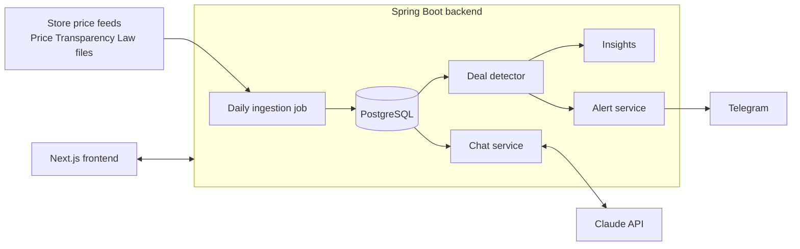

# DealsAndPriceTracker

> **The Shahar and Keren Project**: tracks prices across Israeli retailers and alerts you to real deals, not fake discounts.

## Table of Contents

- [Executive Summary & Objective](#executive-summary--objective)
- [Key Functional Features](#key-functional-features)
- [MVP](#mvp)
- [Technical Stack](#technical-stack)
- [Repository Layout](#repository-layout)
- [Database Schema](#database-schema)
- [High-Level Architecture](#high-level-architecture)
- [Running Locally](#running-locally)
- [API](#api)
- [Roadmap](#roadmap)

## Executive Summary & Objective

**Problem Statement:** Israeli retailers (e.g., supermarkets like Shufersal, Victory and Rami Levy, and pharmacies like Super-Pharm) frequently run marketing promotions, multi-buy offers, or temporary price cuts. Consumers struggle to tell significant savings apart from minor discount noise or artificial "sale" prices based on inflated reference prices.

**Objective:** Build a data-driven full-stack application that regularly ingests and tracks product prices across Israeli retail and supermarket sites, uses an AI agent to detect genuine, non-trivial price drops, and dispatches real-time alerts via Telegram/WhatsApp.

## Key Functional Features

### Feature 1: Product Tracking & Search

- **User Input:** Users paste a product URL or enter a search query via the web interface.
- **Product Normalization:** Extracts product name, brand, volume/quantity metric (e.g., 500g, 1L), baseline price, and store brand ID.

> **Status:** Search by brand/name and category filter are implemented. Products are normalized by barcode, with brand, size label (e.g. "Size 4", "Stage 1"), pack quantity and unit type. Adding a product by pasted URL is not built yet.

### Feature 2: Automated Price Ingestion Worker

- **Scheduled Ingestion:** Cron-driven worker (every 6–12 hours) fetching updated prices and active store promotions/multi-buys.
- **Time-Series Storage:** Saves historical price snapshots per product store location.

> **Status:** Implemented as a scheduled job (`DailyJob`, daily at 06:00 Israel time for the MVP; configurable via `INGESTION_CRON`). Sources plug in through a `PriceSource` interface. A parser for Price Transparency Law files (`PriceFull` / `PromoFull` XML, plain or gzipped) is implemented and tested. Until per-chain file discovery is built, a synthetic `SamplePriceSource` provides data for development.

### Feature 3: Smart Deal & Fake Discount Detection Agent

- **Threshold Filter:** Ignores minor fluctuations or trivial discounts (e.g., < 15% drop).
- **AI Evaluation Rules:**
  - **Historical Moving Average:** Calculates a true 30/60-day average price baseline.
  - **Price Anchoring / Fake Discount Detection:** Flags items where the "original price" was raised right before being marked down.
  - **Multi-Buy Unit Price Calculation:** Evaluates 1+1 or "buy 3 for 50 ILS" offers to compute true per-unit savings.

> **Status:** All rules are implemented in `DealDetector` (deterministic, unit-tested). A sale is flagged as fake when the advertised original price is higher than any regular price in the last 30 days, or when the regular price was raised in the week before the markdown. Each evaluation includes human-readable reasons, shown in the UI.

### Feature 4: Alert & Notification Dispatcher

- **Supported Channels:**
  - **Telegram Bot API:** Instant direct message with a deal breakdown link.
  - **WhatsApp (Twilio / Green API / WhatsApp Business API):** Messaging integration.
  - **Web-App Push Notifications:** Web push alerts triggered via browser Service Workers (using the Web Push API / Firebase Cloud Messaging), even when the site isn't actively open.

> **Status:** Telegram is implemented (`TelegramNotifier`); alerts run after each ingestion, at most once per rule per day. WhatsApp and Web Push plug into the same `Notifier` interface but aren't built yet. Alert rules are created through the API; there is no UI for them yet.

## MVP

**Scope:** Collects diaper and baby food data from local branches in Yad Eliyahu of:

- Yochananof
- Osher Ad
- Carrefour
- Super-Pharm
- Good Pharm
- Tiv Taam

**Product list:** Diapers and baby food.

### MVP Features

- [x] See the product list
- [x] Choose a product and see its price table (plus a 60-day price history chart)
- [x] Insights, at most 4: real deals on top, then *"Cheapest diaper is `<brand>` in `<store>`"* (per diaper / per 100 g, within the same diaper size or formula stage) for the products you starred
- [x] Accounts (email + password) and a per-user list of starred products
- [x] In-app chat to ask questions (Claude, grounded in the current price table)

### Definition of Done

- [ ] Deployed on AWS (database on AWS as well): see [docs/aws-deployment.md](docs/aws-deployment.md)
- [ ] Available online
- [ ] Daily price collection: the scheduled job is in place; real store feeds still need to be connected
- [ ] Daily notification (if relevant): Telegram alerts are in place; needs deployment and a bot token

## Technical Stack

| Layer | Technology Choice | As built |
| --- | --- | --- |
| **Backend** | Java 21 + Spring Boot 3 (Spring Web, Spring Data JPA, Spring AI) | Java 21 + Spring Boot 3.5 (Web, Data JPA, Validation, Actuator), Flyway migrations |
| **Frontend** | Next.js 14+ (App Router, React, Tailwind CSS, shadcn/ui) | Next.js 14 (App Router) + Tailwind CSS; shadcn/ui not added yet |
| **Database** | PostgreSQL + pgvector (stores time-series price snapshots & product embeddings) | PostgreSQL 16; pgvector not used yet (no embeddings in the MVP) |
| **AI Framework** | Spring AI (integrated with OpenAI GPT-4o / Claude / Gemini APIs) | Official Anthropic Java SDK (Claude) for the chat; deal detection is rule-based |
| **Web Scraping / Data Ingestion** | Playwright / JSoup / Official Supermarket Open APIs (Cerelac / Israeli Food Transparency Law Data) | Price Transparency Law XML parser; synthetic source for development |
| **Notifications** | Telegram Bot API / Web Push API / WhatsApp Green API | Telegram Bot API |

## Repository Layout

```
backend/   Java 21 + Spring Boot 3 (REST API, ingestion, deal detection, alerts, chat)
frontend/  Next.js 14 (App Router) + Tailwind CSS
docs/      Deployment notes
```

| Backend package | What it does |
| --- | --- |
| `ingestion` | `PriceSource` interface, `SamplePriceSource`, `TransparencyPriceSource` + `TransparencyFileParser`, `IngestionService`, `DailyJob` |
| `deals` | `DealDetector` and `PriceAnalysisService` (latest price + history → deal evaluation and unit price) |
| `insights` | Up to 4 insights: genuine deals first, then cheapest per unit for the sizes / stages the user watches |
| `auth` | `AuthService` (accounts, BCrypt passwords, bearer-token sessions) and `WatchlistService` |
| `notification` | `Notifier` interface, `TelegramNotifier`, `DealAlertService` |
| `chat` | `ChatService`: Claude via the Anthropic Java SDK |
| `api` | REST controllers |

## Database Schema

The draft schema from the PRD stored one `products` row per store. To compare the same product across stores, the implemented schema splits it in two:

| Table | Purpose |
| --- | --- |
| `stores` | Store branches (chain, branch name, city, Price Transparency Law chain/store codes) |
| `products` | Canonical product, unique by barcode: title, brand, category, size label, unit quantity and type |
| `product_listings` | A product sold at a specific store (optional product URL) |
| `price_snapshots` | Time series per listing: `price`, `original_reference_price`, `is_promotion`, `promotion_description`, plus `promo_min_quantity` / `promo_total_price` for multi-buy offers |
| `alert_rules` | As in the draft, plus `last_notified_at` to send at most one alert per day |

Full DDL: [`backend/src/main/resources/db/migration`](backend/src/main/resources/db/migration).

## High-Level Architecture

<!-- TODO: export the architecture diagram from the PRD and save it as docs/architecture.png -->



## Running Locally

Requirements: Java 21, Maven, Node 20+, PostgreSQL 16 (or Docker).

```bash
# Everything in Docker
docker compose up --build

# Or run the pieces yourself
cd backend && ADMIN_TOKEN=devtoken mvn spring-boot:run      # expects Postgres on localhost:5432
cd frontend && npm install && npm run dev                    # http://localhost:3000
```

Load ~45 days of synthetic history so deal detection has something to work with:

```bash
curl -X POST -H "X-Admin-Token: devtoken" "http://localhost:8080/api/admin/backfill?days=45"
curl -X POST -H "X-Admin-Token: devtoken" "http://localhost:8080/api/admin/ingest"
```

Set `ANTHROPIC_API_KEY` to enable chat and `TELEGRAM_BOT_TOKEN` to enable Telegram alerts. All configuration options are listed in [docs/aws-deployment.md](docs/aws-deployment.md).

## API

| Method | Path | |
| --- | --- | --- |
| GET | `/api/products?category=DIAPERS\|BABY_FOOD&q=` | Product list with lowest price |
| GET | `/api/products/{id}` | Price table across stores, with deal evaluation |
| GET | `/api/products/{id}/history?days=60` | Price history |
| GET | `/api/insights` | Insights (send the bearer token to get "cheapest" insights for watched products) |
| POST | `/api/auth/register`, `/api/auth/login` | `{ email, password }` → `{ token, expiresAt, user }` |
| POST | `/api/auth/logout`, GET `/api/auth/me` | `Authorization: Bearer <token>` |
| GET | `/api/me/watchlist` | Watched product ids (bearer token required) |
| PUT / DELETE | `/api/me/watchlist/{productId}` | Watch / unwatch a product (bearer token required) |
| GET | `/api/stores` | Tracked stores |
| POST | `/api/chat` | `{ "messages": [{ "role": "user", "content": "..." }] }` |
| POST | `/api/alerts` | `{ productId, channel: "TELEGRAM", recipientId, targetDiscountPercentage }` |
| GET / DELETE | `/api/alerts[/{id}]` | Admin token required |
| POST | `/api/admin/ingest`, `/api/admin/backfill?days=N` | Admin token required (`X-Admin-Token` header) |

## Roadmap

- [ ] Real data: per-chain discovery of the latest `PriceFull` / `PromoFull` files, and filling in `chain_code` / `store_code` for the Yad Eliyahu branches from each chain's Stores file
- [ ] Deploy to AWS
- [ ] UI for subscribing to alerts
- [ ] WhatsApp and Web Push notifiers
- [ ] Add a product by pasting its URL (Feature 1)
